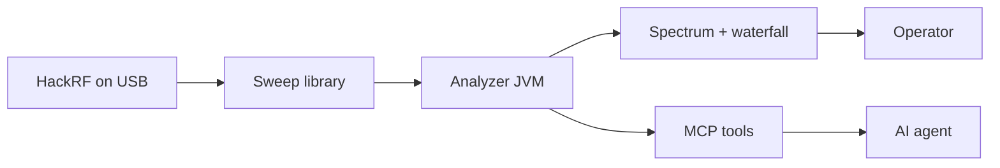

# MCP — AI agents on the live sweep

This is **HotIron**: a HackRF desktop with a Model Context Protocol (MCP) interface. You watch the plot. A local agent (Grok, Claude, Cursor, or anything that speaks MCP) **copies the RF bins**, on the **same JVM**, without opening a second rig.



Start it with `make start` (MCP on `127.0.0.1:8765` by default). Point the agent at `scripts/mcp-hotiron-proxy.py`. Ask what is on the air.

## What an agent can answer

| Question | Tool |
|---|---|
| Where is the peak, and how loud is the noise? | `spectrum_summary` |
| Give me the filled bins (optional `maxPoints`, `minDbm`) | `spectrum_snapshot` |
| What radio is attached (board, serial, firmware, USB API)? | `radio_identity` |
| What is the radio vs display config (range, FFT, gain, `autoSweep`, `radioMode`, `tvChannel`, `tvLocked`)? | `sweep_config` |
| Park Watch on a US ATSC channel (2–36) | `tv_watch` |
| What is the live local RF spectrum around the TV channel being watched? | `tv_spectrum` |
| Where is ATSC Watch failing (IQ, segment/field sync, RS, PAT, FFmpeg)? | `tv_debug` |
| How have those ATSC stages changed over recent samples? | `tv_debug_history` |
| Park Listen on a US FM dial (88.1–107.9) | `fm_listen` |
| Which US FM dial hits are live right now? | `fm_stations` |
| Which TV bricks are occupied / ATSC-like / picture / no-lock on this HackRF? | `tv_stations` |
| What is going on at 13.56 MHz (field, poll, HiFER/CW, A/B/F/V sidebands)? | `nfc_activity` |
| Park NFC sniff (11.56 MHz / 10 MS/s, receive only) | `nfc_sniff` |
| What L1 bricks are occupied (GPS/Galileo, BDS, GLONASS)? | `gnss_activity` |
| Park GPS L1 C/A sniff (1575.42 MHz / 4 MS/s; not a fix) | `gnss_sniff` |
| Which GPS C/A PRNs did parked sniff just list? | `gnss_sv` |
| Which US CB 11 m AM channels are occupied? | `cb_channels` |
| Park CB AM listen on channel 1–40 | `cb_listen` |
| Set the existing Auto gain checkbox | `auto_gain` |
| Leave Listen/Watch/Sniff and restart the sweep | `sweep` |
| What NFC frames did the parked decoder just name? | `nfc_frames` |
| Start or stop parallel nRF BLE sniff (sets sweep to 2400–2484; does not park USB) | `ble_sniff` |
| What BLE PDUs did the nRF sniffer just name? | `ble_frames` |
| BLE frame ring plus the current HackRF spectrum summary | `ble_activity` |
| Put a note on the operator Spectrum tools / plot HUD | `operator_brief` |
| Read last agent notes per face | `operator_briefs` |
| What is the live local RF spectrum around the station being heard? | `fm_spectrum` |
| What is occupying the window (width, fraction, Wi-Fi ch / NFC label)? | `spectrum_occupancy` |
| How did peak/noise/occupancy move over the last few seconds? | `spectrum_history` |
| Give me the last few seconds of filled bins (time-frequency stack, not the waterfall image) | `spectrum_history_bins` |

Hop holes are **omitted**, not reported as −150 dBm. Snapshots are sampled at most **10 Hz**. `spectrum_history` returns **summaries** from the ring (~20 s), not full bin arrays, and starts a new series when the MHz/FFT window changes. `spectrum_history_bins` serializes those same ring frames (`points` per tick; optional `seconds`, `maxSamples` ≤50, `maxPoints`, `minDbm`). It is the time-frequency stack the waterfall is painted from, not the PNG. Occupancy is deterministic (noise+8 dB, merge adjacent bins); Wi-Fi views may label `ch 6`, BLE views may label `BLE 39`, NFC views may label `13.56` / `NFC-A/B`, GNSS L1 views may label `GPS` / `BDS` / `GLO`. `ble_sniff` opens the bench nRF ACM (second USB) the same way the sidebar does; it does not park the HackRF. `ble_frames` / `ble_activity` only read the ring. `operator_brief` writes a per-face note onto the operator **Agent brief** pane and a one-line plot HUD (optional `marks` at MHz). It does not open USB. `operator_briefs` reads those notes. `nfc_activity` is the live 13.56 MHz **sweep** classifier (`kind`, duty, `pollHz`, sidebands, `trackingHint`) from the same sweep bins; it does not decode payloads or find AirTags. `nfc_sniff` parks the same exclusive RF path as the sidebar Sniff control (LO 11.56 MHz, 10 MS/s). `nfc_frames` is the recent named-frame ring from that decoder (tech, name, hex). `gnss_activity` is the live RNSS L1 **sweep** occupancy (GPS/Galileo 1575.42, BDS, GLONASS) from those bins — not a GPS fix. `gnss_sniff` parks GPS L1 C/A at 1575.42 MHz / 4 MS/s. `gnss_sv` is the last-known PRN list (C/N0, Doppler); a missed 1 ms search does not clear it. `tv_stations` is the Seek roster (`grade`: `picture` / `atsc_like` / `occupied` / `no_lock`, plus PSIP `station` such as `"7.1 KATV"` when TVCT is decoded); `picture` means MPEG-2 frames on this HackRF, not sweep occupancy. `tv_watch` and `fm_listen` park the same exclusive RF path the operator uses (US TV ch 2–36, or FM 88.1–107.9). `auto_gain` writes the existing Auto gain checkbox (`AnalyzerSettings.isAutoGain`). `sweep` is the same as Stop / `restartSweep`. LNA/VGA values stay on the existing gain models. `sweep_config` includes `radioMode` (`sweep`/`listen`/`watch`/`nfc`/`gnss`/`stopped`), `listenMHz`, `tvChannel`, `tvLocked`, `tvSnrDb`, `tvPackets`, and display `autoSweep`. `fm_spectrum` is the live ±2 MHz dBFS view derived from Listen's parked IQ; `tv_spectrum` is the corresponding ±8 MHz Watch view. Neither opens another USB path. `tv_debug` labels the current failing stage (`no_segment_sync`, `no_field_sync`, `rs_unusable`, `no_pat`, `waiting_rs_health`, then FFmpeg-side `ffmpeg_missing` / `ffmpeg_exited` / `ffmpeg_blocked` / `no_pmt` / `no_video_pid` / `no_video_pes` / `ffmpeg_waiting` / `picture`), includes a `diagnosis` object (`code`, `fix`, `text` for clipping, weak/missing signal, adjacent interferer, off-centre pilot, or multipath), and exposes queue, AGC, equalizer (`eqSnrDb`, `cfoHz`, `sroPpm`, `clipFraction`, `spectrumSnrDb`, `interfererDb`), packet-error, and an `ffmpeg` object (process alive/exit, TS bytes offered vs written, queue drops, stdout/partial-frame, last stderr, PAT/PMT/video PID counts, plus PSIP `virtualChannel`, `callSign`, `subchannels`). `tv_debug_history` returns up to 200 recent diagnostic samples. The same FFmpeg counters are on the 2 s `ATSC watch:` console line. While listening, watching, or sniffing NFC, `spectrum_snapshot` / `spectrum_history` / `spectrum_history_bins` / `spectrum_occupancy` follow the parked-IQ FFT (dBFS magnitudes in the `dbm` fields) and start a new history series when the dial, TV channel, or sniff window moves. Wideband `fm_stations` stay stale; use `fm_spectrum` / `tv_spectrum` for the full local bins.

## Start

The GUI owns USB. MCP TCP on that process is on by default:

```bash
make start               # GUI + listen on 127.0.0.1:8765
./src/hotiron/build/hotiron/hotiron.sh --no-mcp   # GUI only
# optional: --mcp-port=8765   --mcp-stdio
```

Client config (stdio proxy; the analyzer must already be listening):

```json
{
  "mcpServers": {
    "hotiron": {
      "command": "python3",
      "args": ["scripts/mcp-hotiron-proxy.py"],
      "env": { "HOTIRON_MCP_PORT": "8765" }
    }
  }
}
```

Run the proxy from the repo root (or pass an absolute path to the script).

## Why this shape

- **One radio.** A second `hackrf_sweep` would fight the GUI for USB.
- **Same data as the plot.** The store is filled from `onFullSweepProcessed`, not from screenshots or log scraping.
- **Safe for agents.** JSON-RPC on localhost / stdio. No LAN listen in v1. No USB restart from a snapshot tool.
- **Operator-first defaults.** Auto gain, auto-scale dB, and a waterfall time axis so humans and agents see a usable band.

The operator sidebar (and the status-bar **MCP** field) shows bind address, connected clients (`initialize.clientInfo.name`), and the last tool call. **MCP off** means this process was started with `--no-mcp`.

Implementation: `hotiron.mcp` (`SpectrumSnapshotStore`, `SpectrumMcpServer`, `SpectrumMcpTools`) plus `McpStatus` for the UI. Writes go through `FmListenHook` / `TvWatchHook` on the EDT (same `AnalyzerSettings` as the operator). Snapshot tools only read the store. Design notes: [architecture.md](architecture.md). Operator UI: [operator.md](operator.md).
