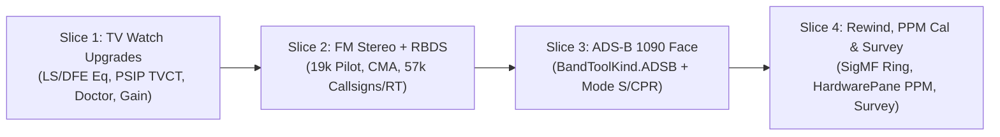

# OnAir (`b7cf9ac`) Port — In-Place HotIron Upgrades

**Status:** in progress (TV slice done: Cholesky LS/DFE equalizer, PSIP TVCT virtual channels/callsigns, `TvWatchDebug` doctor diagnostics, and quality/interferer-aware `TvWatchGainPolicy`)
**Started:** 2026-11-03
**Reference Pin:** `adswill/OnAir@b7cf9ac054e6e392e30e6c265b5810071644f6f1` (GPL-3.0-or-later)

## Goal

Port high-leverage DSP and diagnostic algorithms from `adswill/OnAir` directly into **HotIron**'s existing native (`src-c/`) and Java (`hotiron.core` / `hotiron.ui` / `hotiron.mcp`) layers to fill gaps in TV Watch, FM Listen, ADS-B, and MCP agent diagnostics — without adding a Rust toolchain, CMake, or a second USB owner.

## Checklist

### Slice 1 — ATSC 1.0 TV Watch Upgrades (Done)
- [x] Port OnAir Cholesky SPD least-squares feed-forward (`NTAPS=64` + bias) and decision-feedback (`NDFE=32`) equalizer (`solve_spd`) + segment-sync LMS tracking + decision-directed gain correction into `src-c/atsc/lib/atsc_equalizer_impl.cc`
- [x] Port DC-removed PN511/PN63 field-sync correlation (`atsc_fs_checker_impl.cc`) and squared-Euclidean 8-VSB Viterbi branch metrics (`atsc_single_viterbi.cc`)
- [x] Suppress 52-segment convolutional deinterleaver warmup zero-flush in `atsc_pipeline.cpp`
- [x] Add RS(207,187) error-correction and multipath pre/post-echo self-test in `src-c/atsc/atsc_selftest.cpp` (native gcov 42.7% → 73.6%)
- [x] Port ATSC A/65 PSIP TVCT/CVCT (`0x1FFB` / `0xC8`) virtual channel & callsign decoding into `MpegTsProbe`, `TvStationHit`, `TvChannelRoster`, `TvTunerPanel`, `WatchHud`, `tv_stations`, and `tv_debug`
- [x] Fold Reception Doctor root-cause diagnostics (`clipping`, `iq_drops`, `weak_signal`, `no_signal`, `interferer`, `off_centre`, `multipath_or_low_snr`, `looks_fine`) and telemetry gauges (`clipFraction`, `cfoHz`, `sroPpm`, `eqSnrDb`, `spectrumSnrDb`, `interfererDb`) into `TvWatchDebug` and MCP `tv_debug`
- [x] Upgrade `TvWatchGainPolicy` with `spectrumSnrDb`, `interfererExcessDb`, clip/interferer backoff (`retuneForQuality`), and `chooseOptimalGain`

### Slice 2 — FM Stereo & US RBDS in `WfmDemodulator` + `TunerPanel`
- [ ] 19 kHz pilot bandpass + PLL (`pilotLock`, `pilotSnrDb`) and SNR-blended stereo `L+R` / `L-R` matrix in `WfmDemodulator`
- [ ] 16-tap adaptive CMA multipath equalizer gated by instantaneous-frequency envelope ripple
- [ ] 57 kHz BPSK RDS / US RBDS group decoder (`rbdsCallSign` `K`/`W` callsigns, 8-char PS name, 64-char RadioText, PTY) + `TunerPanel` / `fm_stations` integration

### Slice 3 — Missing `ADS-B` BandTool Face (`QuickSelectPreset.ADSB`)
- [ ] 1090 MHz 0.25 µs pulse preamble detector + coherent phase slicer in `hotiron.core`
- [ ] Mode S CRC-24 error correction + DF11/17/18/20/21 & CPR position/altitude/callsign decoder in pure Java
- [ ] `BandToolKind.ADSB` + `AdsbSniffPanel` + `RadioMode.ADSB` parked at 1090 MHz / 4 MS/s + MCP `adsb_sniff` / `adsb_aircraft`

### Slice 4 — Hardware & MCP Diagnostics (IQ Rewind, PPM Calibration, Long-Term Survey)
- [ ] Rolling `int8` IQ rewind buffer (`SigMF` `.sigmf-meta` + `.sigmf-data`) on ATSC lock drop + MCP `save_rewind`
- [ ] Phase-regression crystal PPM calibration (`fitToneByPhase` + `PpmAverager`) from ATSC pilot or FM pilot in `HardwarePane` + MCP `calibrate_ppm`
- [ ] Compact `0.5 dB` pairwise-merging `BandSurvey` + `find_quiet` slots + richer receive-only MCP range/gain control
